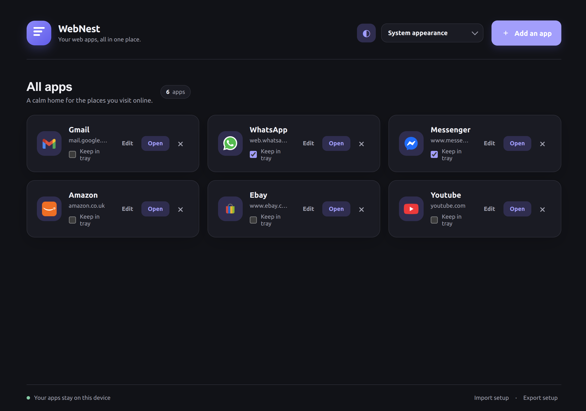

# WebNest

Your web apps, all in one place.

WebNest is an Electron desktop web-app manager, starting with Linux Mint. The first milestone focuses on a small, secure shell for creating website apps, opening each app in its own persistent session, configuring appearance, and backing up app configuration.



## Run

Requires Node.js 22 or newer.

```sh
npm install
npm start
```

Build a Debian package with:

```sh
npm run dist:linux
```

Install the generated Debian package with your package installer or `sudo apt install ./dist/webnest_0.1.33_amd64.deb`. WebNest creates a separate Linux applications-menu launcher and icon for each app. Launch a website from its menu entry, then pin that running app to the panel or dock if desired. Each app can opt in to opening its internal popup links in in-window tabs. Tab selections and open internal pages are restored after restarting the app. Leave the option off for apps that need separate popup windows, such as Zoho Mail's print window. To build an AppImage instead, run `npm run dist:appimage`.

## Prototype scope

- Add and remove web apps by name and URL. HTTPS is required for public sites; HTTP is allowed for local, private, or loopback addresses (e.g. `http://192.168.x.x`, `http://localhost`).
- Open an app in a separate window with a dedicated persistent Electron session.
- Give the WebNest manager and each created app a separate Linux desktop identity so each has its own menu and dock icon. Linux starts a small WebNest process for each app to provide that identity.
- Close an app window to hide it and keep its current page alive for fast reopening; use **Quit** in the tray menu to close all windows and release memory.
- Restore each app's last same-site page and window size when reopened.
- Light, dark, or system appearance.
- Per-app camera, microphone, and notification permissions, disabled by default and restricted to the app website. Screen capture and other website permissions stay denied.
- Minimize the manager to the system tray; use the tray menu to restore or quit.
- Export and import versioned JSON configuration containing app settings and metadata.
- Renderer has no Node.js access; a narrow preload API mediates manager actions.
- Encrypt local app configuration with Electron `safeStorage` when the desktop provides an OS credential store; encrypt Chromium cookies at rest using Electron's cookie-encryption fuse and OS cryptography.

## Disclaimer

WebNest is an independent project and is not affiliated with or endorsed by the websites or services you add. Their names, logos, and content belong to their respective owners. WebNest is a desktop wrapper; each third-party service controls its own terms, availability, privacy practices, and security. WebNest is a prototype, with no guarantee of compatibility or suitability for sensitive activity. Do not assume it is safe for banking or other high-risk uses; assess the security and compatibility of your setup before relying on it.

Configuration backups include names, HTTPS URLs, appearance, optional icons, and per-app permission choices. They never include cookies, passwords, session tokens, last-page URLs, or window sizes. On Linux, encryption strength depends on the desktop's available Secret Service or portal credential provider.
